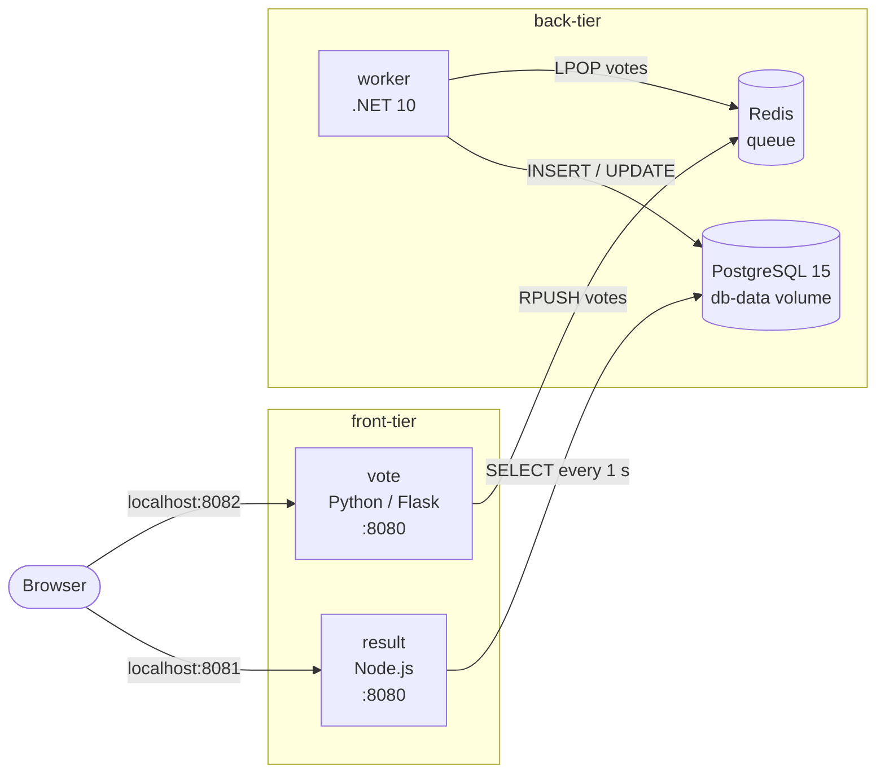
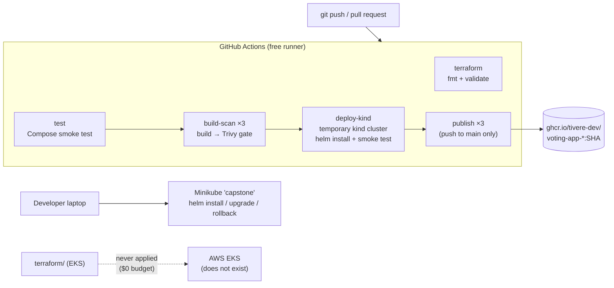

# Capstone 1: Ship It (Voting App)

DevOps capstone project by **Tivere Madagwa**, built on a fork of
[dockersamples/example-voting-app](https://github.com/dockersamples/example-voting-app).

The goal of the capstone is to take the Voting App from local development
through hardened containers, infrastructure as code, CI/CD and a Helm
deployment with rollback.

> **Zero-cost scope.** This project is being completed with a budget of
> **$0**. No cloud account is used and no cloud resources are created. The
> cloud requirements of the brief are covered by reviewable code and clearly
> labelled local substitutes. See
> [Cloud requirement and limitation](#cloud-requirement-and-limitation).

## Status

Last updated: 23 October 2026. Only results that were actually run are marked
as verified.

| Stage | What it covers | Status |
|---|---|---|
| 1. Run locally | Docker Compose, cast a vote, see it counted | Verified on macOS 13 (Intel), Docker Desktop 28.5 |
| 2. Containerize safely | Pinned base images, non-root users, `.dockerignore`, health checks | Verified locally and in CI |
| 3. Terraform | EKS cluster in the default VPC | Code in [terraform/](terraform/). `fmt` and `validate` pass in CI. **Never applied: no AWS cluster exists.** |
| 4. GitHub Actions | Tests, Trivy scan, build, deploy test, push tagged with the commit SHA | Verified. The full pipeline, including `publish`, passed on the push to `main` ([run 39977351502](https://github.com/tivere-dev/example-voting-app/actions/runs/39977351502)). Three images are on GHCR, tagged with commit `6f25524b25523a2f8135f2baa5d403630c864b58` (see [Published images](#published-images)). |
| 5. Helm | One chart, one values file, bad release, `helm rollback` | Verified on **local Minikube** (evidence in [docs/evidence/](docs/evidence/)) and on a temporary kind cluster in CI |

## Architecture



1. `vote` accepts a vote and pushes it onto the Redis list `votes`.
2. `worker` pops votes from Redis and writes them to PostgreSQL. Each browser
   (identified by a `voter_id` cookie) has one vote that it can change.
3. `result` reads the totals from PostgreSQL every second and pushes them to
   the browser over Socket.IO.

If the worker stops, votes wait in Redis and are processed when it returns.
This was tested: 3 votes queued while the worker was stopped were all saved
after it restarted.

### Delivery path



## Running locally with Docker Compose

Prerequisites: Docker Desktop (or another Docker Engine with Compose v2).

```bash
docker compose up -d --build --wait
```

| Page | URL |
|---|---|
| Vote | http://localhost:8082 |
| Result | http://localhost:8081 |

The host ports can be changed without editing the Compose file, for example
`VOTE_PORT=9000 RESULT_PORT=9001 docker compose up -d`. Inside the containers
both web apps listen on port 8080.

Check that a vote is stored end to end:

```bash
scripts/smoke-test.sh
```

Optional load: `docker compose --profile seed run --rm seed` sends 3,000 votes.
The worker processes roughly 10 votes per second, so the results page catches
up over about five minutes.

Stop the app and keep the votes:

```bash
docker compose down
```

Stop the app and delete the votes:

```bash
docker compose down -v
```

## Container hardening (Stage 2)

| Image | Base (pinned by tag and digest) | Runs as |
|---|---|---|
| vote | `python:3.13.16-slim-trixie` | UID 10001 |
| result | `node:24.22.0-trixie-slim` | UID 1000 (`node`) |
| worker | `mcr.microsoft.com/dotnet/runtime:10.0.13-noble-chiseled` | UID 1654 (`app`) |
| seed | `python:3.13.16-slim-trixie` | UID 65534 |
| redis | `redis:8.10.2-alpine` | UID 999 (`redis`) |
| db | `postgres:15.19-alpine` | UID 70 (`postgres`) |

- Python dependencies are pinned to exact versions, and npm installs from
  `package-lock.json` with `npm ci`.
- Application code is owned by root and is read-only for the app user.
- The vote and result health checks use Python and Node directly, so `curl`
  is not installed in the images.
- pip is removed from the vote image after the dependencies are installed.
  Trivy found a CRITICAL vulnerability in the certifi copy bundled inside pip,
  and the app never installs packages at runtime.
- The worker image has no shell or package manager. Its connection string
  disables Npgsql's GSS (Kerberos) encryption attempt, which needs a library
  the chiseled image does not include.

## CI/CD pipeline (Stage 4)

Defined in [.github/workflows/ci.yml](.github/workflows/ci.yml). It runs on
pushes to `main`, on pull requests into `main`, and manually.

| Job | What it does | Can change anything? |
|---|---|---|
| `terraform` | `terraform fmt -check`, `init -backend=false`, `validate` | No. No AWS credentials exist in the workflow. |
| `test` | Builds the stack with Compose and runs [scripts/smoke-test.sh](scripts/smoke-test.sh) | No |
| `build-scan` (vote, result, worker) | Builds the image, runs a Trivy report and a Trivy gate, and saves the scanned image as a one-day artifact | No |
| `deploy-kind` | Creates a temporary kind cluster (Kubernetes 1.37) in the runner, loads the scanned images, runs `helm lint --strict` and `helm install --wait`, then runs the smoke test | No. The cluster is deleted when the job ends. |
| `publish` (vote, result, worker) | **Only on a push to `main`, after every job above passes.** Pushes the scanned images to `ghcr.io/tivere-dev/voting-app-<service>:<commit SHA>` | Yes: creates or updates GHCR packages. It is the only job with `packages: write`. |

The image that is deployed and published is the one Trivy scanned: it is
passed between jobs as an artifact, not rebuilt.

### Trivy scanning

- **Report step:** lists every HIGH and CRITICAL finding and never fails.
- **Gate step:** fails the job on any **CRITICAL vulnerability that has a
  fix available**, or any secret found in the image. Unfixed findings are
  excluded because no update exists to remove them; they stay visible in the
  report.
- Trivy runs from its official image **pinned by digest** (v0.75.0). This
  avoids the March 2026 Trivy supply-chain incident (GHSA-69fq-xp46-6x23),
  in which version tags of `aquasecurity/trivy-action` were moved to
  malicious code. Images referenced by digest were not affected.

The gate caught two real problems on the first run, which were fixed:

| Image | Finding | Fix |
|---|---|---|
| vote | certifi 2026.6.17, CRITICAL (GHSA-6q48-6c7w-9gw2), plus 3 HIGH, all bundled inside pip | Remove pip from the final image |
| result | proxy-addr 2.0.7, CRITICAL (CVE-2026-90711), plus HIGH findings in express, body-parser, path-to-regexp, engine.io, socket.io-parser and ws | Refresh `package-lock.json` within the existing `package.json` ranges |

Latest results ([run 39977351502](https://github.com/tivere-dev/example-voting-app/actions/runs/39977351502), the push to `main`; the same as the last pull-request run):

| Image | Gate | Remaining report findings |
|---|---|---|
| vote | Passed (0 fixable CRITICAL) | 44 HIGH, all in Debian packages with no fix released yet |
| result | Passed (0 fixable CRITICAL) | 43 HIGH in Debian packages (no fix yet) and 4 HIGH in the npm copy bundled with the Node image |
| worker | Passed | None |

### Pipeline security

- The workflow token is read-only by default; only `publish` adds
  `packages: write`, and it never runs on pull requests.
- Every third-party action is pinned to a full commit SHA.
- No repository secrets are used. GHCR login uses the built-in
  `GITHUB_TOKEN`.

CI evidence:

- [Run 39747352711](https://github.com/tivere-dev/example-voting-app/actions/runs/39747352711): the first run, where the gate failed vote and result
- [Run 39748720764](https://github.com/tivere-dev/example-voting-app/actions/runs/39748720764): all green after the fixes
- [Run 39764140784](https://github.com/tivere-dev/example-voting-app/actions/runs/39764140784): all green including `deploy-kind`
- [Run 39977351502](https://github.com/tivere-dev/example-voting-app/actions/runs/39977351502): the push to `main` after merging pull request #2. Every job passed. On
  the first attempt, `publish` failed for result only: GHCR answered
  `unknown blob` after nine of ten layers had uploaded. Re-running only that
  job (attempt 2) pushed it with no other changes, and the run is green.

The first three are pull-request runs, so `publish` was skipped. The fourth
ran `publish`.

### Published images

Each push to `main` publishes the three scanned images to the GitHub Container
Registry, tagged with the full commit SHA. The verified images come from merge
commit `6f25524b25523a2f8135f2baa5d403630c864b58`:

| Package | Image | Digest |
|---|---|---|
| [voting-app-vote](https://github.com/tivere-dev/example-voting-app/pkgs/container/voting-app-vote) | `ghcr.io/tivere-dev/voting-app-vote:6f25524b25523a2f8135f2baa5d403630c864b58` | `sha256:9288fe8a172f4c2703f1cff58387bcfc0ef51e7383f34e1730a11f210fce347c` |
| [voting-app-result](https://github.com/tivere-dev/example-voting-app/pkgs/container/voting-app-result) | `ghcr.io/tivere-dev/voting-app-result:6f25524b25523a2f8135f2baa5d403630c864b58` | `sha256:1081ba9245a7d3d30c2fe952bb31c336240e28359647641ab2a722658e270fce` |
| [voting-app-worker](https://github.com/tivere-dev/example-voting-app/pkgs/container/voting-app-worker) | `ghcr.io/tivere-dev/voting-app-worker:6f25524b25523a2f8135f2baa5d403630c864b58` | `sha256:749c0948d08d4b00497a16410f2052d4b1913c4b7ab9d199b6fcae26e5514e96` |

The packages are **public** and can be pulled without logging in:

```bash
docker pull ghcr.io/tivere-dev/voting-app-vote:6f25524b25523a2f8135f2baa5d403630c864b58
```

How this was checked: requesting each image's manifest from `ghcr.io` with an
anonymous token (no GitHub login) returned HTTP 200 and the digests above,
which match the `docker push` output in the CI log. Each image's config blob
also downloaded anonymously (HTTP 200). The package pages also
open without signing in. The packages took the visibility of this public
repository. Visibility was never changed by hand.

## Kubernetes and Helm (Stage 5)

The chart is in [helm/voting-app/](helm/voting-app/), with one values file,
[values.yaml](helm/voting-app/values.yaml).

- Deployments and Services for vote, result, worker, Redis and PostgreSQL.
  The PostgreSQL credentials are in a Secret, and the data is on a 1 GiB
  PersistentVolumeClaim that is kept if the release is uninstalled.
- Every container runs as a non-root UID, with a read-only root filesystem,
  no privilege escalation and all Linux capabilities dropped.
- vote, result, Redis and PostgreSQL have readiness and liveness probes.
- vote, result and worker roll out with `maxUnavailable: 0`: a working pod is
  only removed once its replacement is ready.
- `appImage.tag` is required (normally the git commit SHA). The Service names
  are fixed (`vote`, `result`, `redis`, `db`) because the app code uses those
  hostnames, so one release fits in each namespace.

### Running it on Minikube

[scripts/local-cluster.sh](scripts/local-cluster.sh) creates the local
environment from code. It uses a dedicated Minikube profile, `capstone`, and
does not change the default kubectl context.

```bash
scripts/local-cluster.sh up
```

`up` starts Minikube, builds and loads the images, and runs
`helm upgrade --install --wait`.

```bash
scripts/local-cluster.sh status
```

```bash
minikube -p capstone kubectl -- --context capstone -n voting-app port-forward svc/vote 8082:8080
```

```bash
minikube -p capstone kubectl -- --context capstone -n voting-app port-forward svc/result 8081:8080
```

```bash
scripts/local-cluster.sh down
```

`down` deletes the `capstone` profile and its data. It asks you to type the
profile name first.

### Bad release and rollback

The demonstration changes one value to an image tag that does not exist:

```bash
helm --kube-context capstone -n voting-app upgrade voting-app helm/voting-app --reuse-values --set vote.image.tag=does-not-exist --wait --timeout 90s
```

```bash
helm --kube-context capstone -n voting-app history voting-app
```

```bash
helm --kube-context capstone -n voting-app rollback voting-app 1 --wait
```

Recorded results on local Minikube
([evidence](docs/evidence/stage5c-bad-release-rollback.txt)):

- Revision 2 failed after the 90 s wait. The new vote pod stayed in
  `ErrImagePull` / `ImagePullBackOff`.
- The old vote pod was never removed, and the vote Service routed only to it.
  34/34 checks through port-forward and 34/34 checks inside the cluster
  through the Service returned HTTP 200.
- `helm rollback voting-app 1` created revision 3 ("Rollback to 1"), and the
  smoke test passed again.

### Rebuilding the environment from code

[Evidence](docs/evidence/stage5d-rebuild-from-code.txt):

- `scripts/local-cluster.sh down --yes` deleted the cluster in 11 s.
- `scripts/local-cluster.sh up` rebuilt it in 157 s, with a new node, a fresh
  Helm release (revision 1), all pods ready and a passing smoke test.

This is a **local Minikube substitute** for the brief's "destroy and recreate
the cluster"; it does not involve AWS. The first install is recorded in
[stage5b-minikube-install.txt](docs/evidence/stage5b-minikube-install.txt).

## Cloud requirement and limitation

The brief asks for Terraform to create a Kubernetes cluster **in the default
VPC**, then destroy it and recreate it from code. Capstone 2 then runs on
that cluster. A default VPC is an AWS concept, and a managed AWS cluster
(EKS) costs money: about $0.10 per hour for the control plane alone (AWS
price list, September 2026). Even the AWS Free plan needs a payment card at
sign-up.

Because the budget is $0, the approach is:

- **No AWS account, no cloud resources, no `terraform apply`.**
- Terraform code for an EKS cluster in the default VPC is written for review.
  `terraform fmt -check` and `terraform validate` pass in CI; neither needs
  credentials or creates anything. `terraform plan` cannot run without an AWS
  account, so no plan output is claimed.
- Kubernetes work runs on **Minikube on this laptop** and on a temporary
  **kind** cluster inside the CI runner. **Neither is EKS, and neither meets
  the "default VPC" requirement.**
- CI/CD uses GitHub Actions and the GitHub Container Registry. Both are free
  for public repositories on standard GitHub-hosted runners.

My instructor has said that projects which run successfully locally and meet
the capstone requirements may be submitted, so this local-first approach is
the plan of record.

### What has been shown, and what needs a real cloud cluster

| Requirement (from the brief) | Shown at $0? | Evidence |
|---|---|---|
| Fork the repo, run with Docker Compose, vote is counted | Yes | Verified locally and in CI (`test` job) |
| Pinned images, non-root, `.dockerignore`, every image builds and starts | Yes | Verified locally, on Minikube and in CI |
| Terraform code for a Kubernetes cluster | Yes, as code | [terraform/](terraform/); `fmt` and `validate` pass in CI |
| Cluster created **in the default VPC**, destroyed and recreated | **No** | Needs an AWS account. Not performed. |
| "The environment rebuilds from code" | Partly | Minikube deleted and rebuilt with one script ([evidence](docs/evidence/stage5d-rebuild-from-code.txt)). Local substitute, not AWS. |
| Each push runs tests, a Trivy scan and a build | Yes | On pull requests and on the push to `main` ([CI evidence](#pipeline-security)) |
| Images pushed tagged with the commit SHA | Yes | Three public GHCR images tagged `6f25524b25523a2f8135f2baa5d403630c864b58` ([Published images](#published-images)) |
| "One push builds, scans and **deploys**" | Partly | Every run deploys the chart to a temporary kind cluster and tests it. That cluster is deleted when the job ends; there is no persistent deployment. |
| One Helm chart, one values file | Yes | [helm/voting-app/](helm/voting-app/) |
| Bad release on purpose, then `helm rollback` | Yes | On Minikube ([evidence](docs/evidence/stage5c-bad-release-rollback.txt)); can be repeated live |
| No secrets in Git | Yes | Secret scan before every commit; no repository secrets |
| Architecture diagram | Yes | [Architecture](#architecture) and [Delivery path](#delivery-path) above |
| Capstone 2 on "your Capstone 1 cluster" | **No** (substitute) | Capstone 2 will run on Minikube instead, limited by laptop memory and disk |

## Known limitations

- **No AWS cluster has ever been created.** The EKS Terraform has not been
  planned or applied, so the default-VPC and destroy/recreate requirements
  are only met by the local substitute.
- **The published images are public.** Anyone can pull them. According to
  GitHub's documentation, a public package cannot be made private again; it
  can only be deleted. Every push to `main`, including documentation-only
  changes, runs the pipeline and publishes a new set of images tagged with
  that commit.
- **The kind deployment in CI is temporary.** The images are published to a
  registry, but nothing keeps running anywhere after the job ends.
- **Database password:** PostgreSQL uses upstream's demo login
  (`postgres`/`postgres`). It is stored in a Kubernetes Secret, but the worker
  and result code contain the same value, so it cannot be changed in the
  chart alone.
- **Redis has no password.** It is only reachable through a cluster-internal
  (ClusterIP) Service, and there is no NetworkPolicy.
- **Single replicas, single node.** Each component runs one pod, and Minikube
  is one node, so this shows rollout behaviour, not high availability.
- **Access is through `kubectl port-forward`.** There is no Ingress or load
  balancer.
- **Remaining HIGH findings** in Debian system packages have no fix released
  yet. The npm copy bundled in the Node image also has 4 HIGH findings.
- **Upstream behaviour kept as is:**
  - The worker handles about 10 votes per second (it sleeps 100 ms per vote).
  - If the database connection drops, it can lose the vote it was
    processing. This comes from reading the code and was not tested.
  - The results page logs one error at first start, until the worker has
    created the `votes` table.
- **Not used:** upstream's `result/tests` (Node 8 and PhantomJS) and the
  `k8s-specifications/` manifests (upstream images on port 80). The smoke
  test and Helm chart replace them.
- **Not run:** ShellCheck (not installed), so shell scripts were only checked
  with `bash -n` and by running them.

## Repository layout

| Path | Purpose |
|---|---|
| `vote/`, `result/`, `worker/` | Application services and their Dockerfiles |
| `seed-data/` | Optional load generator (Apache Bench) |
| `healthchecks/` | Health check scripts for Redis and PostgreSQL (Compose) |
| `docker-compose.yml` | Local stack (production images) |
| `terraform/` | EKS cluster in the default VPC, for review only (see its [README](terraform/README.md)) |
| `helm/voting-app/` | Helm chart and its single `values.yaml` |
| `scripts/smoke-test.sh` | End-to-end check used locally, on Minikube and in CI |
| `scripts/local-cluster.sh` | Create, inspect and delete the local Minikube environment |
| `.github/workflows/ci.yml` | CI/CD pipeline |
| `docs/evidence/` | Command output recorded from the Minikube install, rollback and rebuild |
| `k8s-specifications/`, `docker-stack.yml`, `docker-compose.images.yml` | Upstream examples, not used by this capstone |

## Security notes

- No secrets, credentials, tokens or Terraform state are committed. The
  Terraform `.gitignore` excludes state, plans and real `.tfvars` files.
- Containers run as non-root everywhere (Compose, Minikube and kind).
- The demo PostgreSQL password is a known limitation (see above).

## Attribution

Capstone work by Tivere Madagwa. The application code comes from
[dockersamples/example-voting-app](https://github.com/dockersamples/example-voting-app)
(Apache License 2.0, see [LICENSE](LICENSE)). Upstream's notes: the app accepts
one vote per browser, and it is a teaching example rather than a
production-ready design.
