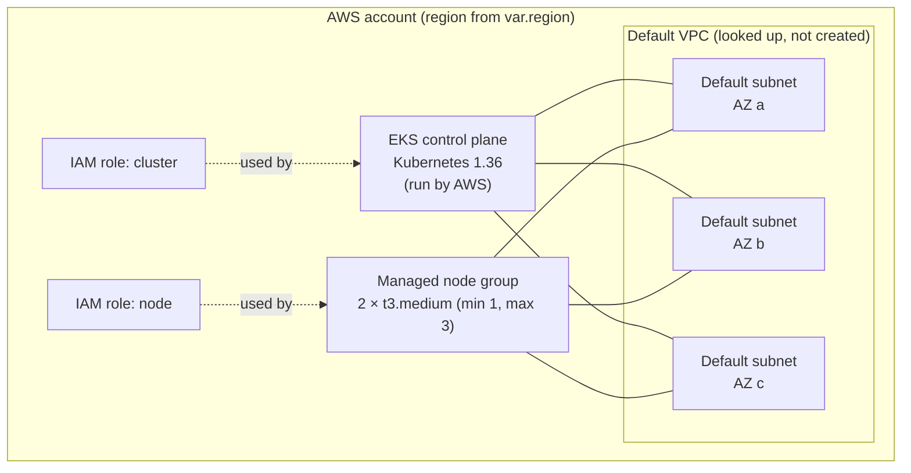

# Terraform: EKS cluster in the default VPC

This folder describes the cloud infrastructure the capstone brief asks for:
an Amazon EKS (Kubernetes) cluster in the account's **default VPC**, which can
be destroyed and recreated from code.

> **Not applied.** This project has a $0 budget, so no AWS account was used.
> `terraform plan`, `apply` and `destroy` have **never been run** against AWS,
> and no cluster has been created. See [What has been checked](#what-has-been-checked).

## What it would create

| File | Contents |
|---|---|
| `versions.tf` | Required Terraform (≥ 1.10) and AWS provider (6.x) versions; local state |
| `providers.tf` | AWS region and tags added to every resource |
| `variables.tf` | Settings you can change (region, sizes, allowed IPs) |
| `network.tf` | **Looks up** the default VPC and its subnets. Nothing is created or changed in the network. |
| `iam.tf` | Two IAM roles: one for the EKS control plane, one for the worker nodes |
| `eks.tf` | The EKS cluster, a launch template for node settings, and a managed node group |
| `outputs.tf` | Cluster name, API endpoint, version, subnets and the `kubectl` setup command |
| `terraform.tfvars.example` | Example values. Copy it to `terraform.tfvars`, which Git ignores. |

## Design decisions

| Decision | Why |
|---|---|
| Plain `aws_*` resources, not a community module | Every resource is visible and can be explained line by line. Only one provider is needed. |
| Default VPC and its public subnets | Required by the brief. Nodes get public IPs, so no NAT gateway is needed. |
| `api_allowed_cidrs` has no default and rejects `0.0.0.0/0` | The Kubernetes API is not left open to the whole internet by mistake. |
| `upgrade_policy.support_type = "STANDARD"` | Prevents the cluster from moving into paid EKS extended support. |
| `cpu_credits = "standard"` on nodes | t3 instances slow down when out of burst credits instead of billing extra. |
| IMDSv2 required on nodes | Blocks a common way of stealing node credentials. |
| Encrypted gp3 root disks, 20 GiB | Encrypted at rest; small and cheap. |
| Control plane logging off | Avoids CloudWatch log charges for a short-lived demo cluster. |
| Access entries (`authentication_mode = "API"`) | The modern EKS access model. Whoever runs `apply` becomes cluster admin. |
| Local state, ignored by Git | State can contain sensitive values. A remote S3 backend is an optional extra. |

## What has been checked

| Check | Result | Notes |
|---|---|---|
| `terraform fmt -check -recursive` | Passed (21 Oct 2026, Terraform 1.17.0) | Checks layout and HCL syntax. Needs no download. |
| `terraform validate` | **Not run locally** | Needs the AWS provider plugin (191 MB). Planned to run in GitHub Actions. |
| `terraform plan` | **Not possible** | Needs AWS credentials and reads a real account. |
| `apply`, `destroy`, recreate | **Not performed** | Would create billable resources. |

## How it would be used, with an AWS account

These steps are documented for completeness. **None of them were run for this
capstone.**

1. Sign in to AWS without long-lived keys (AWS CLI 2.32 or newer): `aws login`
2. Copy `terraform.tfvars.example` to `terraform.tfvars`, then set your
   region and your own IP in `api_allowed_cidrs`.
3. Download the provider: `terraform init`. Commit the created
   `.terraform.lock.hcl` file.
4. Check the code: `terraform fmt -check` and `terraform validate`.
5. Preview: `terraform plan -out=tfplan`. Read the plan. On a fresh account
   it should say **`Plan: 9 to add, 0 to change, 0 to destroy`**: 2 IAM
   roles, 4 policy attachments, 1 launch template, the cluster and the node
   group. Nothing in the VPC should appear, because the VPC is only read.
6. Create: `terraform apply tfplan` (EKS takes roughly 10–15 minutes).
7. Connect: run the `configure_kubectl` output, then `kubectl get nodes`.
8. Destroy: `terraform destroy`. Confirm the plan lists only this project's
   resources.
9. Recreate: run steps 5–6 again, then step 7 to confirm.

Expected cost while running, from the AWS price list (September 2026,
on-demand): the control plane is $0.10/hour, and each t3.medium node is
$0.0416–0.0456/hour depending on region, plus $0.005/hour per public IPv4
address. That comes to about $0.20/hour for the default size. Destroying the
cluster stops these charges.

## Local substitute

Kubernetes, Helm and rollback are demonstrated on **Minikube** on the
developer laptop instead. Minikube is a single-node practice cluster. It is
not EKS and does not demonstrate the default-VPC requirement.
